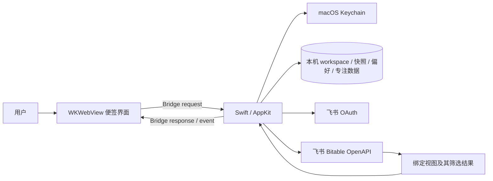
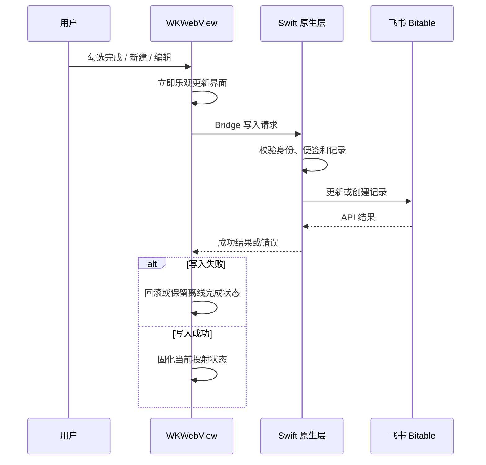

# Todo macOS 桌面便签看板 SPEC

版本：1.0（按当前源码校准）

更新日期：2026-10-28

平台：macOS 13+

状态：本文描述当前仓库源码。代码存在不等于已在所有飞书租户、视图类型和干净 macOS 环境完成端到端验收；外部验收状态须单独记录。

## 1. 产品定义与原则

Todo 是独立运行的 macOS 桌面应用，以便签形式投射用户有权限访问的飞书多维表格视图。它不是飞书内插件，不修改飞书客户端。用户可从 Dock、Spotlight、应用程序目录或命令行启动；不会监控飞书进程、随飞书启动或注册 macOS 登录项。

飞书多维表格是普通任务的唯一事实来源。Todo 将任务新建、编辑、完成/撤销、删除和日期迁移写回所选表格。账号绑定、视图快照、界面偏好、固定事项模板和番茄专注数据保存在本机。应用复用视图筛选和顺序，不提供用户可操作的筛选/排序。

## 2. 技术架构

| 层 | 当前实现 |
|---|---|
| 桌面 | Swift 5.9、SwiftPM executable、AppKit、macOS 13+ |
| UI | WKWebView 中随包提供的 HTML/CSS/原生 JavaScript；无 React、Vite、Node 运行时 |
| 原生桥接 | WKWebView 消息请求/响应；原生负责窗口、授权、存储、通知和网络 |
| 飞书 | Swift URLSession 直连 OAuth 与 Bitable OpenAPI，无公网令牌后端 |
| 资源打包 | macOS/Package.swift 将 Sources/TodoDesktop/Resources 复制到应用资源 |
| 测试 | XCTest；已有 Bitable 客户端及部分绑定/完成状态定向测试 |

应用实际运行页面为 macOS/Sources/TodoDesktop/Resources/prototype.html。此文件名沿用原型阶段命名，但当前是随应用打包的页面；仓库根目录的 prototype.html 是历史独立原型，不是当前运行 UI。

## 3. 功能和行为

### 3.1 账号与便签

- 用户配置自己创建的飞书自建应用 App ID/App Secret，通过系统浏览器 OAuth 授权。
- 每张便签绑定一个 Base、数据表和视图；同一账号同一 view_id 不重复绑定。一个账号可拥有多个便签。
- 当前为单原生窗口模式；便签夹切换活动便签，不是多窗口。
- + 菜单包含新建条目、新建便签；没有活动已绑定便签时，新建条目禁用，新建便签可用。未登录时提供连接飞书入口。
- 关闭当前页保留 binding 和便签夹记录；删除便签只清理对应本机关联、快照、偏好、固定事项/发生记录及专注数据，不删除飞书数据。允许删除最后一张便签。
- 便签夹目标链接失效或无权限时打开失败并保留条目。
- 登出清理 OAuth 身份和令牌，保留 App ID/App Secret 及本地便签数据；重新登录原账号可恢复其 workspace。账号间绑定和写回状态隔离。

### 3.2 字段、视图和投射

| 含义 | 建议名称 | 类型/行为 |
|---|---|---|
| 任务内容 | 任务内容 | 必需文本 |
| 日期 | 所属日期 | 必需日期，用于客户端按日投射 |
| 优先级 | 优先级 | 必需单选，保留飞书视图顺序 |
| 完成情况 | 状态 | 映射为单选“未完成/已完成”，以复选框操作 |
| 计划时长 | 计划时长 | 可选数字，单位小时，步进 0.5；存在时可展示、新建、编辑 |

绑定时优先按标准字段名自动匹配：任务内容、所属日期、优先级、状态；名称匹配忽略首尾空格、全半角差异和大小写，且必须同时满足字段类型。只有唯一匹配才自动采用；缺失或重复时仅要求用户选择对应角色的兼容字段，不猜测。所有自动匹配结果均可通过“手动调整”覆盖。状态必须是恰好包含“未完成”“已完成”两项的单选字段，选项 ID 由 Todo 自动解析。创建绑定前，原生服务仍独立校验字段类型、状态选项和字段不重复。计划时长字段继续按唯一同名数字字段自动识别；缺失、重复或不兼容时隐藏对应能力，不影响其他任务功能。记录查询传入 view_id 并完整分页；应用保留服务端记录顺序，只按本机当前日期匹配已返回的日期字段并分组已完成/未完成。不会重做飞书筛选、不会本地排序。异常必需字段值的记录不进入任务列表并保留投射诊断。日期无记录时统一显示“当前日期暂无待办项，请检查飞书视图筛选”，不判定空数据的具体原因。视图需返回希望在 Todo 使用的日期范围。

### 3.3 任务操作与离线

- **勾选/撤销**：UI 乐观更新并持久化目标状态；原生按记录串行写回状态字段。成功后不等待全视图刷新；失败时恢复或保留可重试状态并提示。不同记录可快速独立操作。
- **新建**：使用当前选择日期、任务内容、必选优先级，状态初始未完成；计划时长字段可用时可选填。UI 先显示，随后由飞书 API 创建确认。若创建已成功但刷新失败，不重复创建。
- **行内编辑**：点击任务内容、优先级或计划时长直接编辑。每次只写回用户编辑的字段，避免覆盖其他字段；同一字段同时在其他客户端修改时，后一次写入会覆盖前一次。失败恢复旧值。可清空计划时长。
- **删除**：任务行原生右键菜单发起并二次确认，删除飞书记录、更新快照并清除该条专注数据。
- **迁移**：对当前视图返回的昨天未完成任务，原生右键菜单提供“迁移到今天”；只更新日期字段，UI 乐观移动，失败回滚。更新后若飞书视图不再返回该记录，以刷新视图结果为准。
- 离线展示最近成功快照；完成/撤销可入本机队列，网络恢复后由原账号重试。新建、编辑、删除、迁移、固定事项写入要求联网，不加入离线队列。登出暂停队列，切换账号不会发送其他账号队列。

### 3.4 日历、固定事项、番茄钟

**日历**
- 未绑定前可使用月历；任务页可进入月历并选择日期。
- 任务页支持前一天/后一天及回到今天；没有翻页/撕页动画。

**固定事项**
- 模板按账号/便签保存在本机，不新增飞书固定标记字段。
- 用户可在便签管理中查看、添加、编辑、删除模板；模板含内容、优先级及可选计划时长。
- 新建模板后立即为当前选择日期创建普通飞书任务；之后打开或刷新便签时为本机自然日生成当日任务。发生记录在本机记录，避免重复；请求使用 client token。模板删除不删除已生成任务。

**番茄钟**
- 单任务专注累计和配置保存在本机，不写入飞书。默认工作 25 分钟、短休息 5 分钟、每 4 轮长休息 15 分钟；可调整。
- 展示专注累计、当前轮和可选计划时长进度；计划时长超出后可继续专注。
- 切换任务暂停原任务；完成、关闭/退出或系统休眠时停止/暂停活动计时；完整工作轮后可触发系统通知，不播放声音。
- 删除单条任务或便签清理对应专注数据。

### 3.5 个性化与窗口

每张便签支持背景图、透明度、中英文字体、字体颜色及作用范围、粗体和斜体；偏好按账号与便签保存。PNG/JPEG/WebP 背景图上限 5 MiB。

窗口采用标准 macOS 标题栏与系统交通灯控件，标题为 Todo。关闭、最小化、缩放/全屏、标题栏拖动和窗口边缘缩放均由 AppKit/NSWindow 管理，网页不绘制或模拟这些控件；最小化可使用系统黄色按钮或“窗口 > 最小化”（⌘M）。窗口最小尺寸为 270×260 pt。应用隐藏仍由 macOS 应用菜单或 Dock 菜单执行，便签中的置顶操作仍由原生窗口层设置。进度条右侧箭头打开源视图；…菜单不再重复提供该入口。绿色/红色状态点表示飞书数据访问与写回是否可正常使用：无法正常访问或存在待处理写回时显示红色，原因可能是网络、授权、权限或视图读取异常；它不表示某一条记录的写入成功结果。界面不显示“写回中/刚刚同步”等冗余成功过程文字。原生 1 秒 timer 仅用于番茄钟，不轮询飞书。

## 4. 授权、安全与发布

- OAuth 使用系统浏览器，loopback URI http://127.0.0.1:43827/oauth/callback，校验 state 和 PKCE S256；scope 为 bitable:app:readonly bitable:app offline_access。
- 用户在自己可管理的飞书组织创建/配置/启用自建应用，登记重定向地址并授权所需权限。Todo 不发布商店、不部署令牌后端，不要求加入开发者组织。
- App ID/App Secret 与 OAuth token 存在 macOS Keychain；token 按飞书身份存储；不通过 WebView bridge 返回敏感令牌。Debug/Release 都从本机读取凭证，不应把真实凭证提交到仓库。
- Bitable 写入包括创建、更新任务字段、完成状态、删除记录和迁移日期；请求只提交所需字段，避免覆盖其他字段。
- 登出清理 OAuth 身份/令牌但保留应用凭证和本机便签数据；本机重置会清理登录身份/令牌、Application Support 下的 Todo 数据、待绑定链接和窗口位置/大小/置顶设置，保留 App ID/App Secret，不改飞书云数据。当前重置流程没有显式清理 WKWebView localStorage；离线完成队列在重置后的状态需单独验证，不能文档承诺已清空。
- 发布策略为未使用 Developer ID 签名/公证的学习项目 Release，使用 ad-hoc 签名并提供 SHA-256。校验和不证明发布者身份。README 与 release checklist 应提供核验、Gatekeeper 隔离处理及钥匙串首次授权说明。

## 5. 本机数据与生命周期

| 数据 | 当前存储 | 生命周期 |
|---|---|---|
| App ID/App Secret | macOS Keychain | 登出保留；凭证重置可清除 |
| OAuth access/refresh token | macOS Keychain，按身份键 | 登出清除 |
| 账号 workspace/binding | ~/Library/Application Support/TodoDesktop/workspaces/ JSON | 账号隔离；删除便签移除 binding |
| 视图快照 | …/TodoDesktop/snapshots/ JSON | 账号与 binding 隔离 |
| 便签偏好、固定模板/发生记录、背景图 | …/TodoDesktop/note-preferences/ | 账号与便签隔离；删除便签清理 |
| 番茄数据 | …/TodoDesktop/focus-sessions/ JSON | 账号与便签隔离；删除便签清理 |
| 离线完成队列 | WKWebView localStorage | 账号派生键、binding、record 隔离；成功后移除。当前本机重置入口没有显式清理该存储 |
| 活动身份、窗口偏好 | UserDefaults/原生设置 | 当前 macOS 用户；不作为飞书数据 |

启动时恢复身份/workspace/活动便签，加载本地快照并读取当前视图；离线时保留最后快照。关闭便签只隐藏当前 binding；删除便签清理其本地数据；登出清除当前账号令牌和登录身份，但保留账号 workspace、便签和应用凭证，以便再次登录恢复。应用不提供一键清除全部本机数据的入口。

## 6. 模块与内部接口

### 6.1 主要源码模块

- Auth/：OAuth、PKCE、loopback callback、token exchange/refresh 与 Keychain。
- Bridge/：WebView bridge 消息协议、原生路由。
- Domain/：身份、绑定、Bitable 数据和投射模型。
- Services/FeishuBitableClient.swift：视图/字段/记录 HTTP API。
- Services/BitableBindingService.swift：链接解析后绑定、字段映射、任务 CRUD/迁移和投射。
- Storage/WorkspaceRepository.swift：账号 workspace。
- Storage/SnapshotRepository.swift：视图快照及乐观更改。
- Storage/NotePreferencesRepository.swift：个性化、固定事项模板/发生记录。
- Storage/FocusSessionRepository.swift：本机番茄计时状态。
- TodoDesktopApp.swift：AppKit 窗口、菜单、通知和桥接。
- Resources/prototype.html：随包 WebView 界面。

### 6.2 核心 Bridge 请求

| 请求 | 用途 |
|---|---|
| app.bootstrap、app.hide、notes.setPinned | 初始化、应用菜单隐藏、置顶；标准窗口控件由 AppKit 直接处理，不经 WebView Bridge |
| auth.start、auth.credentials.configure、auth.status、auth.signOut | 授权、凭证配置、状态、登出 |
| notes.inspectBinding、notes.createBinding | 检查并绑定视图 |
| notes.list、notebook.list、notebook.open | 便签夹列表与切换 |
| notes.getPreferences、notes.setPreferences | 便签偏好 |
| notes.closeCurrent、notes.deleteBinding、notes.refresh | 关闭、删除绑定、刷新 |
| notes.createTaskOptions、notes.createTask、notes.updateTask、notes.deleteTask | 任务字段选项与 CRUD |
| notes.createFixedTaskOccurrence | 创建固定事项日期发生记录 |
| todos.setDone、todos.moveToToday | 完成状态和日期迁移 |
| notes.openSource | 打开源视图 |
| focus.state、focus.start、focus.pause、focus.completeTask、focus.configure | 番茄计时 |

Bridge 是应用内部协议，不是外部公开 SDK。任务右键经原生上下文菜单处理，不是页面自绘菜单。

### 6.3 Bitable 客户端操作

FeishuBitableClient 当前包含：GET view、分页 GET fields、带 view_id 的分页 GET records、GET 单条 record、POST record、PUT record、DELETE record。请求使用 user access token bearer header。写请求仅发送本次需要修改的字段。

## 7. 数据流与失败策略

**首次连接和绑定：** 配置用户自建应用凭证 → 系统浏览器 OAuth → 本机 loopback 校验 state/PKCE → 交换 token、获取身份并存钥匙串 → 粘贴视图链接 → 解析 Base/table/view 并获取字段 → 按标准名称和类型自动匹配唯一字段，仅要求用户补选缺失或重复项（可手动覆盖）→ 原生服务校验映射及状态选项 → 保存账号 binding → 分页读取并保存快照 → 按所选日期投射 UI。

**任务写入：** UI 先乐观更新；原生校验账号、binding、record 后调用 Bitable API。明确失败时回滚或保留可重试完成状态并显示错误。更新不等待全视图刷新；刷新失败不得把已成功创建的记录重复创建。记录因视图筛选离开结果集时以服务端结果为准。

**离线：** 只对完成/撤销提供离线队列；不离线排队其他写操作。队列按账号、binding、record 隔离，重连后使用原账号处理。身份无法确认、账号不匹配或写入结果不明时不得盲目重放；应先对账确认。

**固定事项：** 本机模板 → 检查账号/binding/日期发生记录 → POST 普通任务并带 client token → 成功后保存本机发生标记。模板不新增 Bitable 字段。

### 7.1 主要链路图

## 8. 性能与视觉约束

- 不引入大型前端框架或 Bitable 后台轮询。
- 打开便签/应用恢复和用户手动刷新读取视图；1 秒 native timer 仅供番茄钟运行。
- 完成/撤销与新建立即给出视觉反馈。
- 不显示冗余同步成功过程文字；状态点反映飞书数据访问/写回是否可用，不限定为网络连通性。
- 任务滚动、已完成列表、优先级布局和窗口最小尺寸下的可用性应保持。
- 背景图最大 5 MiB。源码没有系统化能耗/性能基准；轻量是架构目标，尚未量化验收。

## 9. 测试方案与当前覆盖

### 当前可见 XCTest

- FeishuBitableClientTests：更新仅提交所选字段并解析更新记录；按 ID 读取单条记录。
- BitableCompletionTests：状态映射写回、快照日期编码/解码、刷新读取 view records、旧绑定元数据、绑定创建、写回结果不确定时对账、写回无需等待全视图刷新、拒绝写入不得报告成功。
- 这些定向测试不覆盖所有功能；不能代表 OAuth、钥匙串、UI、真实飞书和所有视图兼容性已验收。

### 单元测试

字段映射/异常值与自动匹配（规范名、空格/全半角/大小写归一、缺失字段、同名歧义、手动覆盖、状态选项不兼容及字段去重）；日期边界和时区；任务 CRUD 最小字段写入；固定事项发生去重；账号/binding 隔离；同记录串行及不同记录快速写回；离线恢复、登出和切账号；番茄轮次/休息/暂停/休眠；窗口边界和图片限制。

### 集成测试

OAuth、PKCE、回调与 Keychain；凭证更换、刷新和登出；Bitable 分页、读写、删除、错误码和权限撤销；绑定服务与快照/队列；固定事项生成/重试；原生菜单到页面状态；本机数据重置不影响云端数据。

### 端到端验收

在真实测试 Base 与干净 macOS 环境验证：首次配置授权、字段名自动匹配及手动调整（标准字段唯一匹配、字段缺失、同名重复、状态选项不兼容）、绑定视图、日期/月历、创建/编辑/完成撤销/删除/迁移、固定事项、番茄钟/通知、离线快照和写回队列、账号切换与登出、关闭/恢复/删除便签、个性化、原生交通灯关闭/最小化/缩放、标题栏拖动、窗口边缘缩放、⌘M 最小化、置顶/隐藏、未签名包和首次 Keychain 复用。记录 macOS 版本、架构、构建方式、权限和每步结果；Explorer 单接口成功不能替代桌面端端到端验收。

## 10. 发布与不支持项

项目通过 GitHub 同时提供源码和 Release；Release 使用 ad-hoc 签名、无 Developer ID/公证，附 SHA-256。打包脚本为 macOS/scripts/package-release.sh 和 macOS/scripts/package-app.sh；前者只构建当前 Mac 架构。

当前不支持/不作为目标：飞书内入口、商店应用、飞书启动 Todo、令牌后端、多窗口、用户自定义筛选/排序、计划时长日合计、专注累计写回飞书、离线新建/编辑/删除/迁移、撕页动效、Windows 规划。

## 11. 仍需真实环境验证

1. 自建应用在不同飞书组织/个人账号的权限和审批差异。
2. 干净 macOS 首次钥匙串授权与跨重启复用、未签名包 Gatekeeper 流程。
3. 目标 Base 完整任务 CRUD、迁移后的视图筛选行为、固定事项创建去重。
4. 通知权限、休眠/退出计时边界、账号切换与离线队列恢复。
5. 不同窗口尺寸、滚动区域、自定义背景下的 UI 可用性。

以上属于运行时验收，不代表对应源码功能不存在。

## 12. 历史接口验证

用户曾在目标测试 Base 的 API Explorer 验证：带 view_id 读取记录符合当时视图筛选/排序；字段包含文本、日期、单选；按单选选项名称 PUT 状态并撤销成功。该记录只证明当时用户、Base、视图和权限下的接口可行，不代表当前 Release 的 OAuth/Keychain/UI 端到端链路已全量通过。

## 13. 参考

- [飞书多维表格 API](https://open.feishu.cn/document/server-docs/docs/bitable-v1/bitable-overview)
- [飞书 OAuth 授权](https://open.feishu.cn/document/authentication-management/access-token/authorize)
- [FloatList](https://github.com/qnianjinri-del/feishu-sign-preview)
- [MarkText](https://github.com/marktext/marktext)

